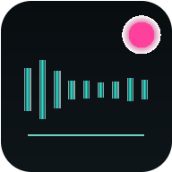

# GRAINLIZER

**GRANULAR AMBIENT INSTRUMENT** — полноценный музыкальный инструмент для iPhone (и любых современных
браузеров): импорт семпла, настоящий гранулярный синтез на AudioWorklet, эффекты,
запись внутреннего мастер-сигнала и экспорт реального стерео WAV. Всё считается
локально в браузере — без сервера, аккаунта и микрофона.



---

## Возможности

| Блок | Что работает |
|---|---|
| **SAMPLE** | Импорт WAV/MP3/M4A/OGG… через `decodeAudioData`, демо-семпл (генерируется программно, оригинальный), осциллограмма (min/max peaks), перетаскивание позиции и краёв диапазона, моно/стерео, короткие файлы, обработка ошибок |
| **GRANULAR ENGINE** | AudioWorklet-гранулы с окном Hann: POSITION, GRAIN SIZE (мс), DENSITY (гранул/с), SPRAY, PITCH (семитоны), RATE, JITTER, REVERSE, FREEZE, MIX; лимит 48 голосов с воровством, сглаживание параметров, защита от NaN/щелчков, авто-перенос чтения внутри диапазона |
| **EFFECTS** | FILTER (LP/HP + резонанс) → TAPE (tanh-насыщение, TONE, WOW/флаттер) → DELAY (TIME ≤1.8s, FEEDBACK ≤0.85, MIX) → REVERB (алгоритмическая свёртка со сгенерированным IR: SIZE/DECAY/MIX) → MASTER (volume, soft-clip, лимитер) + BYPASS |
| **REC** | Внутренний мастер-рекордер (та же шина, что и на выход — без микрофона), таймер MM:SS.ms, TAIL 0/2/5/10 s (хвост эффектов дописывается после STOP), индикаторы REC/CLIP/VOICES, оценка памяти, лимит 20 минут |
| **EXPORT WAV** | Настоящий RIFF/WAVE: 16-bit PCM (format 1) или 32-bit float (format 3, с fact-чанком), стерео, корректные заголовки/размеры чанков; повторный экспорт без новой записи; кодирование в Web Worker |
| **PRESETS** | 12 встроенных: SOFT MEMORY, BROKEN TAPE, GLASS CLOUD, LOST SIGNAL, DEEP SLEEP, DREAM FRAGMENT, NEON DUST, MAGNETIC GHOST, ICE CAVE, SLOW EROSION, STATIC BLOOM, SATELLITE DRIFT + SOFT RND (мягкие вариации вокруг текущих настроек) + RND FULL (смелый музыкальный рандом) + пользовательские пресеты |
| **СОХРАНЕНИЕ** | Настройки/пресеты — localStorage; семпл и проекты — IndexedDB; повреждённые данные и нехватка квоты обрабатываются |
| **PWA** | manifest + service worker (офлайн-кэш app shell), иконки, safe-area, портрет/ландшафт/планшет, установка на экран «Домой» |

### Сигнальная цепь

```
Source (sample) → GranularWorklet → Filter → Tape → Delay → Reverb
   → Master Gain → Soft Clip → Limiter →┬→ Device Output
                                        └→ Recorder Tap (AudioWorklet) → WAV
```

MIX внутри гранулярного движка переключает баланс «сухого» монитора чтения
и гранулярного слоя. Рекордер всегда пишет итоговый мастер-сигнал (включая
все эффекты, изменения параметров в реальном времени и master-громкость).

### Честно про PITCH

PITCH реализован **ресемплингом внутри гранул** (классический гранулярный сдвиг
высоты): длительность гранулы постоянна во времени, её содержимое воспроизводится
с изменённой скоростью. Отдельного независимого time-stretch (phase vocoder) в
этой версии **нет** — сильные сдвиги меняют тембр/скорость материала внутри гранулы.

---

## Запуск локально

Приложение — статические файлы с ES-модулями, поэтому нужен HTTP(S)-сервер
(`file://` не работает: модули и AudioWorklet требуют origin).

```bash
# из корня репозитория
python3 -m http.server 8080
# или
npx serve .
# затем открыть http://localhost:8080
```

Для проверки:

```bash
npm test          # node --test tests/*.test.js (56 проверок)
node scripts/gen-icons.mjs   # перегенерировать PWA-иконки
```

## Публикация по HTTPS и установка на iPhone

1. Загрузите репозиторий на любой статический хостинг с HTTPS
   (GitHub Pages, Netlify, Cloudflare Pages, Vercel и т.п.). Подкаталог допустим —
   все пути относительные.
2. Откройте сайт в **Safari на iPhone**.
3. Нажмите «Поделиться» → **«На экран Домой»** → «Добавить».
4. Запускайте с иконки: откроется standalone-окно без адресной строки.

Service worker кэширует app shell — после первого визита приложение открывается
без сети (сам семпл и проекты живут в IndexedDB на устройстве).

## Ограничения мобильного Safari (iOS)

* **Автоплей:** звук стартует только после касания — показывается баннер «КОСНИТЕСЬ ЭКРАНА ДЛЯ ЗАПУСКА ЗВУКА». Состояние `interrupted` (iOS) восстанавливается автоматически при любом касании и при возврате из фона.
* **Фоновый режим:** при блокировке экрана/сворачивании iOS может приостанавливать аудио; непрерывная фоновая работа **не гарантируется**.
* **Память:** запись хранится в памяти как Float32-чанки (~66 MB на минуту стерео 48 кГц). Есть предупреждение с 5 минут и жёсткий лимит 20 минут с автозавершением.
* **Сохранение файлов:** поведение «Скачать» зависит от версии iOS/Safari (Files, AirDrop, почта).
* **Аудиофайлы:** очень большие файлы могут упираться в память декодирования.
* **Форматы:** что декодирует `decodeAudioData` — WAV, MP3, AAC/M4A, OGG (FLAC — в зависимости от версии Safari).
* Микрофон **не используется** и не запрашивается — разрешения не нужны.

## Архитектура

```
index.html                  разметка (секции приборной панели)
styles.css                  визуальная идентичность
src/main.js                 сборка UI, биндинги, пресеты, PWA
src/audio/
  AudioEngine.js            AudioContext, семплы, транспорт, граф
  granular-worklet.js       DSP гранул (AudioWorkletProcessor, self-contained)
  recorder-worklet.js       тап мастер-шины → PCM-чанки на main thread
  EffectsChain.js           Filter/Tape/Delay/Reverb/Master + лимитер
  Recorder.js               state-машина REC → TAIL → finalize
  WavEncoder.js             RIFF/WAVE кодер (16-bit PCM / 32-bit float)
  wav-worker.js             кодирование вне главного потока
  ExportEngine.js           worker + fallback, повторный экспорт, скачивание
src/ui/
  Waveform.js               Canvas-осциллограмма, selection, playhead
  Controls.js               ручки-кнопки, тумблеры, метры
  RecorderUI.js             транспорт, таймер, статусы
src/state/
  Presets.js                встроенные пресеты, randomize, sanitize
  Storage.js                localStorage + IndexedDB (устойчиво к ошибкам)
public/                     manifest, иконки
service-worker.js           офлайн-кэш (root scope)
tests/                      автотесты (node:test)
scripts/gen-icons.mjs       генератор PNG-иконок без зависимостей
```

## Автотесты

`npm test` — 70 проверок, включая:

* WAV: RIFF-заголовки, размеры чанков, 16-bit конвертация (клампинг, NaN), 32-bit float, mono/stereo, длительность, повторный экспорт;
* гранулярный DSP (реальный процессор в vm-песочнице): ненулевой выход, отсутствие NaN/Inf, лимит голосов, STOP→тишина, PANIC, FREEZE (head не движется), REVERSE, границы буфера, короткие семплы, моно, смена параметров на лету;
* рекордер: точность захвата, flush хвостового блока при STOP, повторные дубли, отсутствие записи вне REC;
* пресеты/рандомайзер: полнота, безопасные границы (feedback ≤ 0.85 и т.д.), repair битых данных;
* блокировку аудио: `resume()` восстанавливает `suspended` **и** `interrupted` (iOS), PLAY/REC дают понятную ошибку вместо тихого отказа;
* storage: round-trip, повреждённый JSON, отказ квоты, отсутствие IndexedDB;
* статическая целостность: все `id` из JS есть в HTML, ассеты существуют, SW precache актуален, модули парсятся.

Тесты выполняются в Node без браузера; **на реальном iPhone в этой сессии не проверялось**.

## Лицензия

MIT
